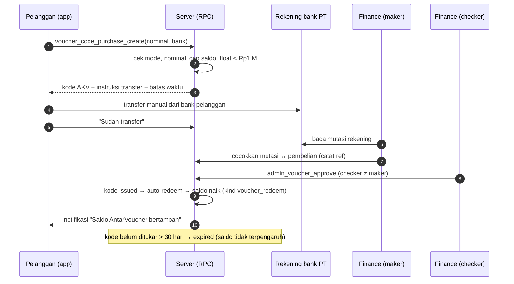
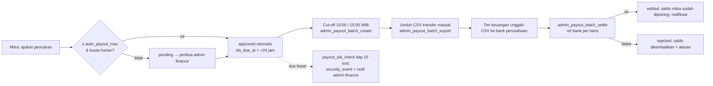

# SPEK-V5 — AntarVoucher v5: Spesifikasi Ringkas untuk Pemilik

Tanggal: 10 Oktober 2026 · Branch `antarvoucher-v5` · Status: ringkasan non-teknis dari `KONTRAK-V5.md` (sumber kebenaran teknis). Bila ada perbedaan, KONTRAK-V5 yang berlaku. Angka bertanda [ASUMSI] adalah nilai awal di pengaturan dan dapat diubah admin lewat PIN tanpa rilis aplikasi.

## 1. Keputusan yang diimplementasikan (ringkasan keputusan pemilik 10 Okt 2026)

| # | Keputusan | Wujud di sistem |
|---|---|---|
| 1 | Perusahaan tidak memegang uang pelanggan sebagai dompet terbuka (tidak ada izin PJP) | AntarVoucher = saldo prabayar **closed loop**: hanya untuk layanan AntarKita, tidak dapat ditransfer antar pengguna, tidak berbunga, bukan simpanan |
| 2 | Kode voucher dibuat aplikasi; uang masuk ke rekening bank perusahaan (transfer manual) | Kode `AKV-XXXX-XXXX-XXXX` terbit otomatis saat pelanggan memilih nominal; instruksi transfer ke rekening PT Antar Kita Indonesia tampil di aplikasi; tim keuangan mencocokkan mutasi bank ≤ 1 hari kerja (maker–checker) |
| 3 | Pencairan by request, SLA 1×24 jam | Setiap permintaan mendapat `sla_due_at` = +24 jam; auto-approve ≤ batas; batch CSV transfer massal diunggah tim keuangan; pelanggaran SLA dilaporkan otomatis ke admin finance |
| 4 | Hapus beban persentase payment gateway | `payment_mode = voucher_only`: Midtrans/Finpay dinonaktifkan (kode dormant). Potongan per transaksi = **PPN + fee AntarKita** saja; tidak ada baris biaya pembayaran |
| 5 | COGS pegawai & biaya lain dibebankan ke transaksi; target transaksi manajer ops & keuangan | `city_targets` per kota per bulan (target order, NPR, driver/merchant aktif, PIC ops & finance); COGS/order = Σ biaya tetap kota ÷ target order; rekomendasi biaya layanan = COGS/order × (1 + margin 30 % [ASUMSI]) dibulatkan ke Rp500 |
| 6 | Berlaku di landing, app pelanggan, app mitra, panel admin | Landing: "Tunai atau AntarVoucher"; S&K v1.5; Privasi v1.4; layar baru di 3 aplikasi (lihat §7) |

Catatan regulasi (riset 25 Sep 2026): voucher prabayar yang hanya berlaku di AntarKita secara substansi = **uang elektronik closed loop** (PADG 32/2025 Ps. 21). **Tidak perlu izin PJP selama total dana float < Rp1 miliar**, tetapi wajib manajemen risiko + pelindungan konsumen, dan BI tetap dapat meminta informasi. Karena itu v5 memasang batas saldo per pengguna, pemantau float, dan S&K closed loop. **Opini hukum tertulis tetap disarankan** (OWNER DECISION, belum ada).

## 2. Alur pelanggan

1. Pelanggan membuka **AntarVoucher** di aplikasi → memilih nominal (Rp20.000 – Rp1.000.000 dari daftar; server menerima Rp20.000 – Rp2.000.000 [ASUMSI]).
2. Server memeriksa: fitur aktif, nominal dalam batas, **saldo + nominal ≤ Rp2.000.000** [ASUMSI batas pelanggan], dan **total saldo beredar + nominal ≤ Rp1 miliar**. Bila lolos → pembelian `awaiting_transfer` + kode `pending_payment`.
3. Aplikasi menampilkan kode AKV, nominal, rekening tujuan, batas waktu transfer, tombol **"Sudah transfer"**.
4. Pelanggan transfer dari banknya sendiri (biaya transfer antarbank, bila ada, ditanggung pelanggan — maks. Rp2.500 BI-FAST).
5. Tim keuangan mencocokkan mutasi rekening perusahaan dengan pembelian (petugas 1) → petugas 2 menyetujui (`admin_voucher_approve`, checker ≠ maker) **≤ 1 hari kerja**.
6. Kode berstatus terbit dan **otomatis ditukar ke saldo** pembeli (`voucher_auto_redeem`); kode tetap tampil sebagai bukti. Kode yang tidak ditukar (mis. hadiah) kedaluwarsa 30 hari.
7. Saat memesan, pelanggan memilih **Tunai** atau **AntarVoucher**. Rincian: ongkir / barang / **"Biaya layanan AntarKita (termasuk PPN 11 %)"** / promo — tidak ada baris biaya pembayaran.
8. Refund pesanan → kembali ke saldo AntarVoucher. Sisa saldo pembelian dapat dimintakan pengembalian ke rekening atas nama sendiri (≤ 14 hari kerja, biaya transfer bank bila ada dipotong). Saldo promo/bonus tidak dapat diuangkan.



## 3. Alur mitra (driver, mitra travel, merchant, pedagang, mobil box)

1. **Deposit.** Driver dan mitra travel wajib saldo ≥ `driver_min_balance_accept` (awal Rp0 [ASUMSI], naikkan setelah stabil) untuk online/terima order. Beranda Mitra menampilkan banner "Beli AntarVoucher" bila kurang; pembelian sama seperti pelanggan, batas saldo mitra Rp5.000.000 [ASUMSI].
2. **Order tunai.** Mitra menerima seluruh uang dari pelanggan; komisi + biaya platform dipotong dari saldo AntarVoucher saat order selesai. **Saldo tidak boleh minus** (`driver_debt_limit = 0`) → saldo turun → mitra membeli voucher lagi.
3. **Order AntarVoucher.** Pendapatan mitra (ongkir − komisi + tip, atau barang − fee) masuk ke saldo saat order selesai.
4. **Rincian pendapatan** di app Mitra: fee AntarKita, PPN (bagian dari fee), bersih; SLA pencairan.
5. **Pencairan.** Mitra mengajukan dari aplikasi → status menampilkan "diproses ≤ 24 jam", waktu jatuh tempo, dan status batch. Tidak ada biaya payment gateway; biaya transfer bank (bila bank mengenakan) ditampilkan sebelum konfirmasi (awal Rp0).



## 4. Alur admin / finance

| Layar | Fungsi |
|---|---|
| Settings → Mode pembayaran | `voucher_only` ↔ `gateway` (superadmin + PIN; reversibel) |
| Settings → Pajak | PPN %, inclusive, PPh mitra % (default 0; aktifkan hanya setelah keputusan pajak) |
| Settings → AntarVoucher | nominal, min/max, batas saldo pelanggan/mitra, ambang float & alarm (65 % [ASUMSI]) |
| Voucher → Pembelian / Kode / Float | antrean verifikasi (maker–checker), status kode, kartu float dengan alarm |
| Finance → Pencairan | antrean dengan sisa SLA & overdue, Buat batch, Unduh CSV, Tandai selesai (ref bank per baris) |
| City costs → Target | target per kota per bulan, PIC ops & finance, progres (on_track / at_risk / behind), COGS/order, rekomendasi biaya layanan |
| Exec | kartu float + progres target |

Kontrol internal: semua mutasi uang lewat RPC `SECURITY DEFINER`; checker ≠ maker; log aktivitas + `security_events`; batas saldo & float dicek di server, bukan di aplikasi.

## 5. Uang: rumus per order (dari KONTRAK-V5 §5)

```
Gross pelanggan G   = ongkir + barang + biaya layanan (PF) + tambahan − promo
Driver              = ongkir − komisi ongkir (ride/box saja) + tip + tambahan
Merchant            = barang − fee merchant
Platform kotor R    = PF + komisi + fee merchant + jasa belanja (porsi platform) + margin antar kota − promo platform
PPN (inclusive) T   = round(R × 11 / 111)          ← entri ledger tax_output
Platform bersih     = R − T
Biaya PG            = 0                              ← tidak ada entri pg_fee
```

Contoh Ride motor Rp50.000 (PF Rp1.000, komisi 8 %): driver Rp46.000; R = Rp5.000; T = Rp495; bersih Rp4.505; pelanggan bayar Rp51.000. Pencairan driver Rp46.000 → batch ≤ 24 jam, biaya Rp0.

Perbandingan dengan gateway (tarif publik riset Sep 2026): QRIS 0,7 % × Rp51.000 ≈ Rp357, VA Rp4.000/trx — pada order kecil VA bisa melebihi seluruh pendapatan platform; itulah beban yang dihilangkan v5.

## 6. Pajak

- **PPN**: biaya layanan AntarKita ditampilkan **termasuk PPN** (`ppn_inclusive = true`, tarif `ppn_pct = 11` [ASUMSI — konfirmasi konsultan pajak]); ledger memposting `tax_output = round(R × ppn/(100+ppn))`; laporan menampilkan pendapatan bersih setelah PPN.
- **Pembelian voucher**: diperlakukan sebagai pembayaran di muka (PMK 6/2021: penyerahan voucer tidak dikenai PPN); pajak melekat saat saldo dipakai untuk layanan. Perlakuan PPN atas jasa transportasi/jasa aplikasi **belum terverifikasi** → konsultan pajak.
- **PPh mitra**: `pph_partner_pct = 0`; bila diaktifkan, entri `tax_output` kedua berlabel pph dan bukti potong tampil di rincian pendapatan mitra.

## 7. COGS & target per kota

- Biaya tetap kota per bulan (gaji, sewa, operasional) diinput admin (`city_fixed_costs`, sudah ada).
- `city_targets`: target order, NPR (pendapatan platform bersih setelah PPN & promo), driver aktif (≥ 10 order/bulan), merchant aktif (≥ 5), PIC ops & finance.
- **COGS/order (target)** = Σ biaya tetap ÷ target order; **COGS/order (aktual)** = Σ biaya tetap ÷ realisasi.
- **Rekomendasi biaya layanan** = ceil((COGS/order × 1,30) / 500) × 500 — ditampilkan di admin/economics; keputusan mengubah tarif tetap di tangan pemilik.
- Status progres pro-rata hari: on_track ≥ 100 %, at_risk 80–100 %, behind < 80 %. Contribution kota = Σ platform bersih − Σ COGS realisasi.

Contoh [ASUMSI]: biaya tetap Pekanbaru Rp30 jt/bulan, target 10.000 order → COGS/order Rp3.000 → rekomendasi biaya layanan Rp4.000 (3.000 × 1,3 = 3.900 → dibulatkan ke 4.000).

## 8. Apa yang berubah bagi pengguna (komunikasi)

| Pengguna | Sebelum | Sesudah v5 |
|---|---|---|
| Pelanggan | Tunai / AntarPay (top up via Midtrans: e-wallet, QRIS, VA) | **Tunai / AntarVoucher** (beli via transfer manual, verifikasi ≤ 1 hari kerja) |
| Driver / travel | Saldo boleh minus s.d. −Rp50.000 | **Deposit AntarVoucher**, saldo tidak boleh minus |
| Semua mitra | Pencairan disetujui admin, tanpa SLA tertulis | **Diproses ≤ 1×24 jam**, status batch tampil, tanpa biaya gateway |
| Rincian pesanan | Biaya platform + (kadang) biaya pembayaran | **"Biaya layanan AntarKita (termasuk PPN)"**, tanpa biaya pembayaran |
| Pembatalan | Biaya pembatalan "dapat dikenai" | **Belum diberlakukan** (keputusan D15 tertunda) |

## 9. Risiko yang akan terasa lebih dulu (analisis, bukan keputusan)

1. **Gesekan onboarding pelanggan** — transfer manual + tunggu verifikasi; sebagian pelanggan akan tetap bayar tunai. Mitigasi: jam kerja finance jelas, notifikasi saldo masuk, nominal kecil tersedia.
2. **Beban finance** — pencocokan mutasi manual; pada > 100 pembelian/hari perlu integrasi mutasi bank (belum ada di kode).
3. **Deposit driver = hambatan masuk** — bila `driver_min_balance_accept` dinaikkan terlalu cepat, pasokan driver turun. Mulai Rp0, naikkan bertahap.
4. **Float mendekati Rp1 miliar** — alarm 65 %; bila tercapai, penerbitan ditahan → pelanggan tidak bisa beli. Siapkan jalur izin PJP atau mitra UE berizin jauh sebelum itu.
5. **Kualifikasi hukum** — tanpa opini tertulis, status "voucher vs UE closed loop" tetap asumsi.

## 10. OWNER DECISION yang masih terbuka

- D-V5-01 Nama badan usaha & nomor rekening resmi di S&K/aplikasi (saat ini "PT Antar Kita Indonesia" [PERLU KONFIRMASI akta]).
- D-V5-02 Tarif PPN 11 % dan perlakuan PPN jasa aplikasi — konsultan pajak.
- D-V5-03 Opini hukum tertulis (BI/konsultan) atas AntarVoucher sebagai UE closed loop.
- D-V5-04 Biaya transfer bank pengembalian sisa saldo: ditanggung siapa.
- D-V5-05 Jangka waktu dormant (12/24 bulan [ASUMSI]).
- D-V5-06 Biaya pembatalan (D15) — tetap "belum diberlakukan" sampai diputuskan.
- D-V5-07 Nilai awal `driver_min_balance_accept` setelah masa transisi.
- D-V5-08 Nama merek saldo di landing: "AntarVoucher" (AntarPay dihapus dari landing sesuai kontrak §4) — konfirmasi.

---
Keterbatasan data: nilai setting di atas adalah default migrasi 0114 [ASUMSI] dan belum diverifikasi di produksi; angka tarif gateway dari riset 25 Sep 2026; regulasi BI mengacu PADG 32/2025 (status PBI 20/6/2018 pasca PBI 10/2025 belum terverifikasi).
